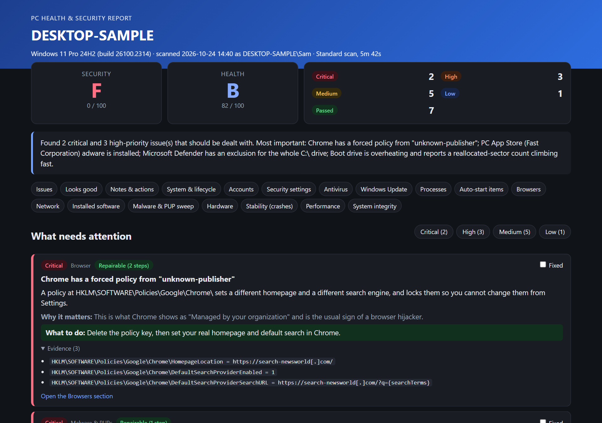
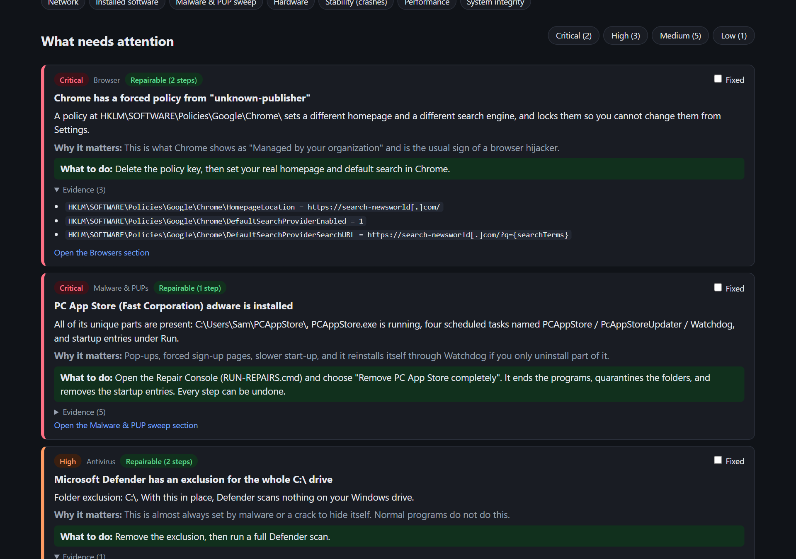
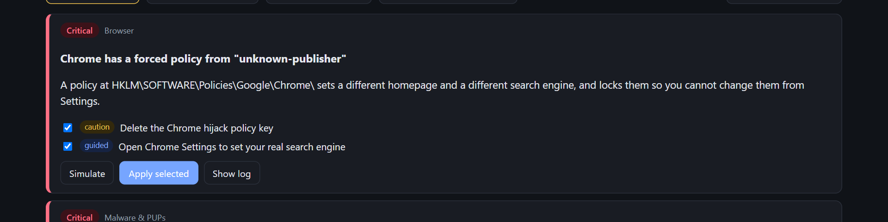

<div align="center">

# PC Health Scan

**A deep, read-only health and security audit for Windows &mdash; and a careful,
undoable fixer when you want to clean up what it finds.**

No install. One PowerShell script. One self-contained HTML report.




<sub><a href="https://tcpeep.github.io/PC-Health-Scan/samples/PC-Health-Report_sample.html"><b>&#128194; Open the live sample report</b></a> &middot;
<a href="https://tcpeep.github.io/PC-Health-Scan/samples/Repair-Console_sample.html"><b>&#128736; Live sample Repair Console</b></a></sub>

</div>

## What it does

**START-SCAN.cmd &mdash; the scan.** Read-only. Looks at everything that
auto-starts, every running process, browser extensions and policies,
Defender's health, Windows settings (UAC, firewall, Secure Boot, TPM,
BitLocker, RDP&hellip;), accounts, network, remote-access tools, Windows
Update, installed software, drive wear, blue screens, crashing programs and
system integrity. Produces one `PC-Health-Report_<PC>_<date>.html` plus
`findings.json` and a `scan-log.txt`. [Full check list &rarr;](docs/checks.md)

**RUN-REPAIRS.cmd &mdash; the Repair Console.** Reads the newest scan and
offers one-click fixes with a live log &mdash; **Simulate** (shows what it
would do, changes nothing) or **Apply** (does it). Everything is reversible:
removed files go to a protected quarantine, settings are backed up first, and
every session gets its own undo journal plus a Windows System Restore point.
[Safety rules &rarr;](docs/safety.md)

<table>
  <tr>
    <td align="center" width="50%"><b>The report</b><br><br></td>
    <td align="center" width="50%"><b>The Repair Console</b><br><br></td>
  </tr>
</table>

## How to use it (e.g. over AnyDesk)

1. Copy this whole folder to the PC (AnyDesk file transfer, USB, etc.).
   Keep the folder structure intact (`START-SCAN.cmd` + the `scanner` folder).
2. Double-click **`START-SCAN.cmd`**.
3. Click **Yes** on the administrator prompt. Over AnyDesk the prompt shows
   on the remote PC's **secure desktop** &mdash; the person at that PC may
   need to click it. (Declining still runs a limited scan.)
4. Pick a mode:
   - **1 Standard** &mdash; everything, ~3-8 minutes (recommended)
   - **2 Deep** &mdash; Standard + Defender definition update + Defender
     quick scan + system file verification (`sfc /verifyonly`), ~20-40 min
   - **3 Quick** &mdash; fewer file-signature checks, ~2-4 minutes
5. The report opens automatically. It's saved under:
   ```
   Reports\<COMPUTERNAME>_<date-time>\PC-Health-Report_....html
   ```
   plus `findings.json` (the raw data) and `scan-log.txt`.
6. Copy the Reports folder back to your PC if you want to keep it.

> [!TIP]
> **"Windows protected your PC" / SmartScreen** on `START-SCAN.cmd`?
> &mdash; click **More info &rarr; Run anyway**. See
> [Troubleshooting &rarr;](docs/troubleshooting.md) if antivirus blocks a script.

## What the report looks like

The HTML report is one file; you can email it or open it on any PC with a
browser. The top shows **Security** and **Health** letter grades, counts by
severity, and a plain-English summary.

- **"What needs attention"** &mdash; every problem with what was found, why
  it matters and exactly what to do. Tick **Fixed** as you go.
- **"Technician notes & actions taken"** &mdash; type what you changed, then
  **Save report** downloads a copy with your notes and ticks baked in (good
  to hand back to the owner).
- **Timeline** &mdash; installs, downloads (with the site they came from),
  new services and tasks, Defender detections and crashes, all in one view.
  Useful for working out how adware got in.
- **Sortable, filterable tables** per section (processes, auto-starts,
  browsers, scheduled tasks&hellip;).
- **SHA256 links** open a VirusTotal **search** &mdash; nothing is uploaded.
  Website addresses are deliberately not clickable.

## The Repair Console

> [!WARNING]
> **The Repair Console changes system settings and removes programs.** Read
> [docs/safety.md](docs/safety.md) before you use it. Everything is
> reversible from inside the console, but you should still have a backup.

After a scan, double-click **`RUN-REPAIRS.cmd`** (admin). It opens a page
listing every issue that has repair steps.

- **Simulate** = shows exactly what would be done; changes nothing.
- **Apply** = does it, streaming a live log line by line.
- Each step has a tick box; untick anything you're unsure about. Steps for
  things that **might be legitimate** (unsigned, but not known adware) start
  **unticked**, with "I recognise it &mdash; trust it" offered first.
- **Risk tags** (set by the engine, not by the scan file):
  <kbd>safe</kbd> = settings only, undoable &middot;
  <kbd>caution</kbd> = removes, ends, deletes, uninstalls or restarts
  something &middot;
  <kbd>guided</kbd> = only opens a settings page.
- **"Apply all safe steps"** can only change settings.
- **Undo** &mdash; every change is recorded with how to reverse it *before*
  it is made. Each applied fix shows **Undo this fix**, and **Undo &
  restore** at the top lists every change ever made on this PC (also earlier
  sessions) with its own Undo/Restore button.

### How the pipeline fits together

```mermaid
flowchart LR
    S[START-SCAN.cmd<br/>read-only] --> J[findings.json]
    S --> H[HTML report]
    J --> R[RUN-REPAIRS.cmd]
    R --> SIM{Simulate or<br/>Apply?}
    SIM -- Simulate --> LOG1[Live log<br/>nothing changes]
    SIM -- Apply --> ENG[Repair engine]
    ENG --> QUAR[Files &rarr; quarantine]
    ENG --> BK[Settings backed up]
    ENG --> UJ[Undo journal<br/>every change]
    ENG --> LOG2[Live log]
    UJ -. any time .-> UNDO[Undo &amp; restore]
    style S fill:#193a1f,stroke:#4ade80
    style SIM fill:#1b1e36,stroke:#818cf8
    style ENG fill:#2a1b1b,stroke:#f87171
    style UJ fill:#1b2a3a,stroke:#60a5fa
```



The engine's hard safety rules are built in; a tampered `findings.json`
cannot make it do anything other than one of its pre-defined fix types.
[Full list &rarr;](docs/safety.md)

### PC App Store &mdash; dedicated complete removal

The scanner has a dedicated module for the **"PC App Store" (Fast
Corporation)** family of adware. It only matches on PC App Store's **unique**
folders, program names and registry keys &mdash; generic names like
`Watchdog.exe` or `AutoUpdater.exe` are never enough on their own.

**"Remove PC App Store completely"** then: removes its startup entries
first &rarr; ends its programs (Watchdog first, which it repeats because the
app restarts it) &rarr; quarantines its folders, files and shortcuts &rarr;
removes its registry keys &rarr; checks nothing is left. Every step can be
undone.

> [!NOTE]
> If PC App Store's full-screen "create your account" page makes the browser
> unusable, use `RUN-REPAIRS.cmd` option **3** (show what would be removed)
> or **4** (remove now) &mdash; it runs in the console window, no web page
> needed.

## Safety

- `START-SCAN.cmd` is **read-only** and contains no code that ends, stops or
  deletes anything. The only changes it can make are in Deep mode: updating
  Defender definitions and running a Defender quick scan.
- **No data leaves the PC.** The report stays in the `Reports` folder.
- The scan relaxes PowerShell's script policy for its own process only
  (`-ExecutionPolicy Bypass`); the PC's policy is not changed.
- Everything else is in the separate Repair Console under the hard rules in
  [docs/safety.md](docs/safety.md).

## Files

| Path | What |
|---|---|
| [`START-SCAN.cmd`](START-SCAN.cmd) | Elevates and runs the scan |
| [`RUN-REPAIRS.cmd`](RUN-REPAIRS.cmd) | Elevates and opens the Repair Console (or runs the PC App Store removal in the console window) |
| [`scanner/PCHealthScan.ps1`](scanner/PCHealthScan.ps1) | Scan entry point |
| [`scanner/modules/`](scanner/modules/) | 15 numbered modules: system, accounts, security, antivirus, updates, processes, persistence, browsers, network, software, malware sweep, hardware, events, performance, integrity |
| [`scanner/lib/Core.ps1`](scanner/lib/Core.ps1) | Shared helpers (findings, repair actions, timeline, etc.) |
| [`scanner/lib/Report.ps1`](scanner/lib/Report.ps1) | HTML report renderer |
| [`scanner/lib/Repair.ps1`](scanner/lib/Repair.ps1) | Repair engine (quarantine, undo, pre-defined fix types) |
| [`scanner/lib/PCAppStore.ps1`](scanner/lib/PCAppStore.ps1) | PC App Store detection and complete removal |
| [`scanner/RepairConsole.ps1`](scanner/RepairConsole.ps1) | Local web server for the Repair Console (127.0.0.1 only, random port + token) |
| [`dev/amsi-check.ps1`](dev/amsi-check.ps1) | After editing: check Defender's AMSI doesn't flag any script |
| [`dev/repair-selftest.ps1`](dev/repair-selftest.ps1) | After editing `Repair.ps1`: real apply/undo round trip, cannot end any program |
| [`scripts/Build-DemoReport.ps1`](scripts/Build-DemoReport.ps1) | Renders `samples/PC-Health-Report_sample.html` from fake findings (for screenshots and the live sample link) |

## Command line

```powershell
powershell -ExecutionPolicy Bypass -File scanner\PCHealthScan.ps1 -Mode Standard -Days 60
```

## Contributing & bugs

Pull requests welcome. Please read [CONTRIBUTING.md](CONTRIBUTING.md) first.
After any change to `Repair.ps1`, run both:

```powershell
powershell -NoProfile -ExecutionPolicy Bypass -File dev\repair-selftest.ps1
powershell -NoProfile -ExecutionPolicy Bypass -File dev\amsi-check.ps1
```

Security issues: [SECURITY.md](SECURITY.md).

## License & credit

PC Health Scan is free software under the [GNU GPL version 3](LICENSE) with
additional terms in [NOTICE](NOTICE): you can use, change and share it, but
copies must keep the author credit in the HTML report, the Repair Console
and the scan's start-up banner.

&copy; 2026 **TCPeep** &mdash; <https://github.com/TCPeep>
