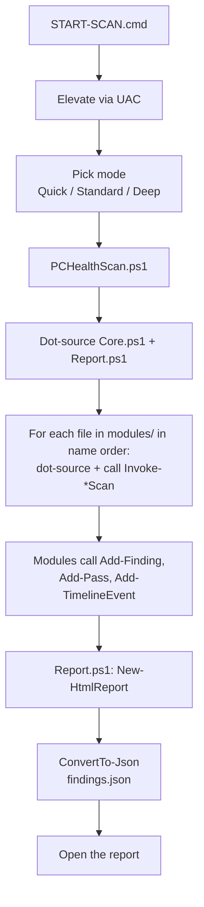
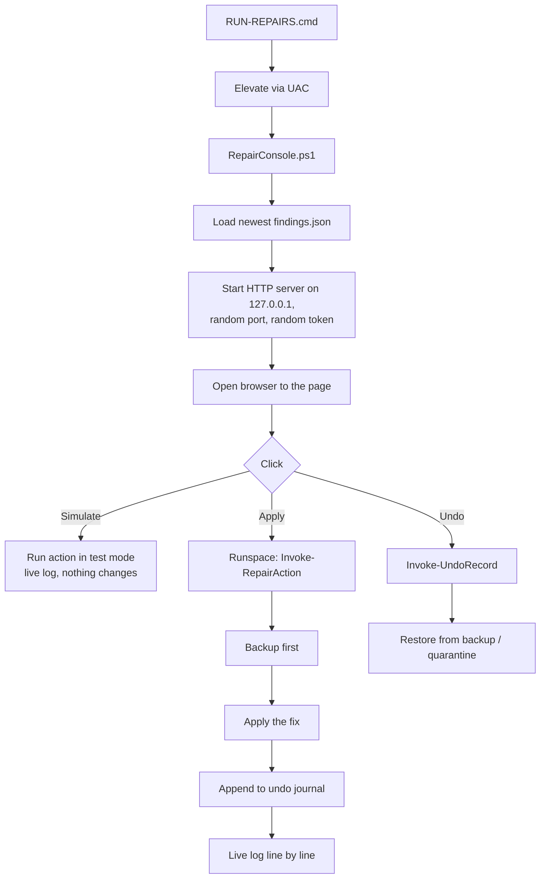

# Architecture

PC Health Scan is one dot-sourced PowerShell 5.1 script tree &mdash; no DLLs, no modules to install, no services. It's deliberately boring on purpose: the fewer moving parts there are on a stranger's PC, the fewer things can break.

## Layout

```
scanner/
  PCHealthScan.ps1       entry: parses args, elevates, dot-sources everything,
                         calls each module in order, writes report + JSON
  lib/
    Core.ps1             shared helpers: Add-Finding, New-RepairAction,
                         Add-TimelineEvent, path/zone helpers, registry helpers,
                         file-signature + hash
    Report.ps1           HTML report renderer + the shared CSS/JS strings
    Repair.ps1           repair engine: pre-defined fix types + undo journal +
                         quarantine + System Restore (used by RepairConsole.ps1)
    RepairPage.ps1       Repair Console web page (served by RepairConsole.ps1)
    PCAppStore.ps1       dedicated detection + removal for PC App Store
  modules/               one file per area; dot-sourced then called in order
    01-System.ps1 ... 15-Integrity.ps1
  RepairConsole.ps1      local web server (127.0.0.1 + random port + token)
                         that runs lib/Repair.ps1 actions on request
  RemovePCAppStore.ps1   console-only PC App Store removal (for when the
                         browser is unusable)
```

## Scan flow



Each module is independent. If one throws, the others still run &mdash; the error ends up in `scanner-errors.txt` next to the report.

## Repair flow



## findings.json: data, not commands

Every repair step is a plain hashtable: a `Kind` (one of `Quarantine`, `StopProcess`, `RegDeleteKey`, `RegSetValue`, `Run`, `Open`, `BrowserReset`, `WmiRemove`, `WindowsFeatureDisable`, `Uninstall`, `RegDeleteValue`) plus parameters.

Only the Repair engine knows what each `Kind` means. A tampered `findings.json` can carry **different parameters** to an existing fix type, but it can't make the engine run arbitrary commands. The engine also re-derives the risk tag from the actual fix type rather than trusting the one in the file.

## The HTML report is self-contained

Everything &mdash; CSS, JavaScript, data &mdash; is inlined into one HTML file (`PC-Health-Report_<PC>_<date>.html`). No external links are followed on open. You can email it or copy it to any PC with a browser.

## No installer, no autostart, no services

Running the tool never creates a scheduled task, a service, a Startup entry or a registry Run key for itself. The only persistent thing it writes is under `C:\ProgramData\PCHealthScan\` (quarantine, undo journal, session logs), which exists only after you've used the Repair Console at least once.
