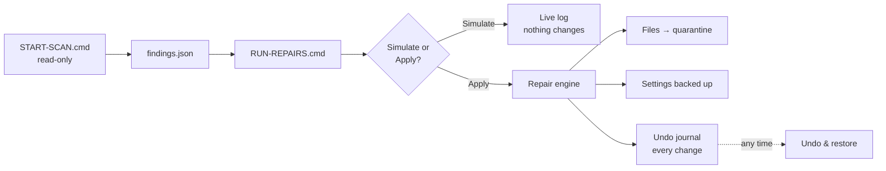

# Safety rules

The Repair Console changes system settings and removes programs. Every change is reversible, but you should still have a backup. These rules are **built into the engine**, not just the page: a tampered `findings.json` cannot make the tool do anything it wasn't designed to do.

## Hard rules

- **Ending programs** targets the **exact unwanted program** only. The engine refuses to end anything in `%USERPROFILE%\AppData`, `%ProgramFiles%`, `%WINDIR%`, or in known tool folders. It **never** ends:
  - any Windows process (`csrss`, `winlogon`, `services`, `smss`, `dwm`&hellip;)
  - any browser (Chrome, Edge, Firefox, Brave, Opera, Vivaldi)
  - any terminal or editor (`cmd`, `powershell`, `windowsterminal`, `code`&hellip;)
  - any remote-access tool (AnyDesk, TeamViewer, RustDesk&hellip;)
  - the tool itself
- **More than 8 processes or 4 programs at once** is refused outright, even if every per-process check would pass.
- **Browsers are never closed for you.** Close them yourself, then click Apply again.
- **Windows' own services and security services are never stopped or deleted.**
- **Folders larger than 2 GB or 5000 files are never quarantined.**
- **Firewall rules** are only removed for the flagged program's full path. Rules that share a name but point elsewhere are left alone.
- **Only pre-defined fix types exist.** `findings.json` carries parameters, never commands. A fabricated or edited findings file cannot inject arbitrary commands.
- **Everything is written to** `Reports\<scan>\repair-log.txt`.
- The Repair Console page accepts requests only when they carry the **session token** printed in the console window. Close the window (or click Finish) when done.

## Pipeline

## What "undoable" means in practice

- **Files and folders** are **moved** to a quarantine folder, not deleted.
- **Registry keys** are exported to .reg files before change.
- **Scheduled tasks and services** are exported before deletion.
- **Firewall rules** are exported.
- **Certificates** removed from a store are exported first.
- **The hosts file** and **browser settings** are backed up first.
- **One System Restore point per session** is created as a last resort.

Journal, backups and quarantine live in **`C:\ProgramData\PCHealthScan`** (administrators only, outside OneDrive so adware is never synced to the cloud). The journal survives sessions &mdash; "Undo & restore" lists every change ever made on this PC, not just the current session.

## Not reversible from the console

- **Uninstalls** performed by the application's own uninstaller.
- **Deleted temp files** cleared by `cleanmgr`.
- **Emptied Recycle Bin.**

The console warns you before any of these.

## Risk tags

Set by the engine, not by the scan file. The console refuses "safe"-labelled steps that are actually caution-level.

| Tag | What it means |
|-----|---|
| <kbd>safe</kbd> | Settings only; nothing is removed or ended. "Apply all safe steps" only touches settings. |
| <kbd>caution</kbd> | Removes, ends, deletes, uninstalls or restarts something. Reversible, but you're changing the PC. |
| <kbd>guided</kbd> | Opens the right Windows settings page or vendor site. The tool makes no change. |

Steps for things that **might be legitimate** (unsigned but not known adware) start **unticked**, with "I recognise it &mdash; trust it" offered first. Trusting a program writes it to `trusted.txt` so later scans won't flag it.

## Not auto-fixable on purpose

Some things are intentionally left as **manual instructions in the report**:

- Hardware faults (a dying drive, failing RAM).
- Driver updates (the right driver depends on your exact device).
- Browser start-page / search resets (reset flows change often; the report shows which keys to open).
- Account passwords.

Rogue root certificates **are** removed, but exported to quarantine first. WMI event-subscription malware is removed with its filters.
